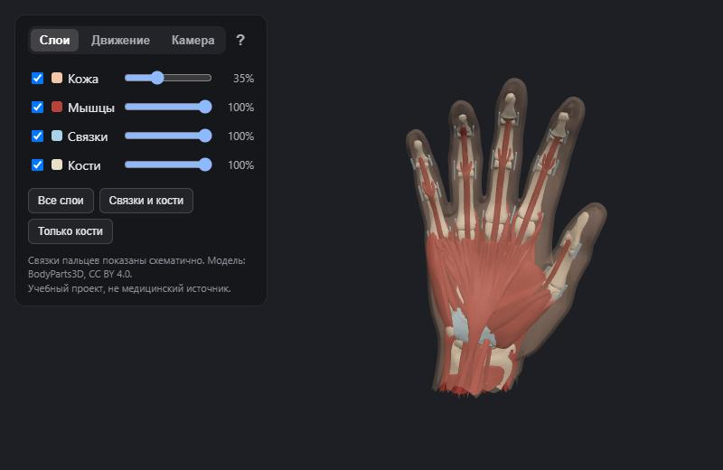
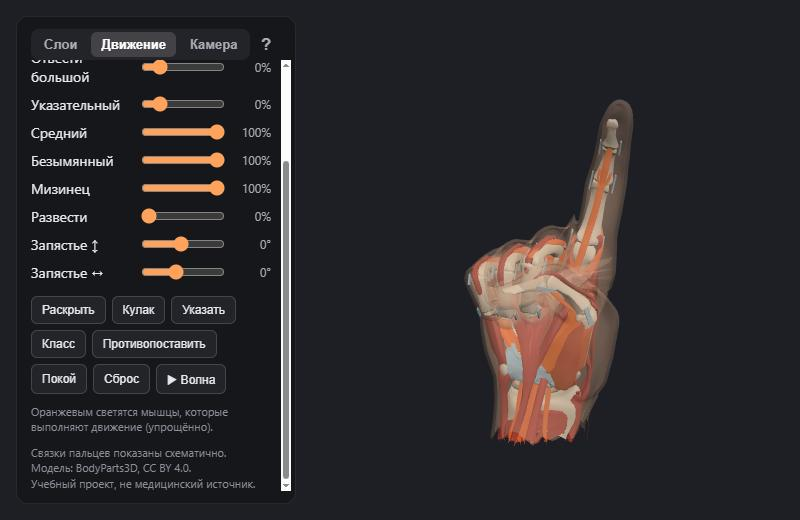
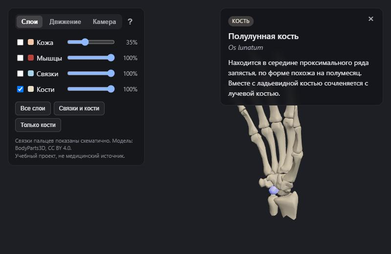

# 3D-анатомия кисти

Интерактивная 3D-модель правой кисти прямо в браузере. Можно снимать слои (кожа → мышцы → связки → кости), узнавать названия частей по-русски и по-латински, сгибать пальцы и управлять моделью своей рукой через вебкамеру.

**Открыть сайт:** _ссылка появится после публикации на GitHub Pages_



| Движение и «работающие» мышцы | Названия и описания |
|---|---|
|  |  |

> Учебный проект. Он не заменяет учебники анатомии и не подходит для медицинских решений.

## Возможности

- **Четыре слоя:** кожа, мышцы, связки, кости. Каждый слой можно скрыть или сделать полупрозрачным.
- **Названия и описания:** наведи курсор, и появится название; кликни — откроется карточка с латинским названием и описанием. В справочнике 89 частей.
- **Движение:** 17 суставов. Пальцы и запястье сгибаются ползунками, есть готовые позы («Кулак», «Указать», «Противопоставить» и другие) и анимация «Волна». Кожа, мышцы и связки двигаются вместе с костями. Мышцы, которые выполняют движение, светятся оранжевым.
- **Управление вебкамерой:** модель повторяет движения твоей руки: сгибание каждого сустава, разведение пальцев, поворот ладони. Жесты с касанием («ОК», щепоть) и кулак с большим пальцем внутри модель тоже повторяет. Видео обрабатывается прямо в браузере и никуда не отправляется.
- **Телефон и компьютер:** на телефоне панель уезжает вниз и сворачивается, вращать модель можно пальцем.

## Как запустить у себя

Сайт состоит из обычных файлов HTML, CSS и JavaScript, собирать его не нужно. Но открыть `index.html` двойным щелчком не получится: браузер не даст загрузить 3D-модель и камеру с «файла». Нужен локальный сервер. Подойдёт любой из двух способов:

1. **VS Code + расширение Live Server:** правой кнопкой по `index.html` → «Open with Live Server».
2. **Python:** в папке проекта выполнить

   ```bash
   python tools/serve.py
   ```

   и открыть http://localhost:5500

Для камеры нужен адрес `localhost` или `https://` (на GitHub Pages это `https`).

## Как это устроено

| Файл | Что делает |
|---|---|
| `index.html`, `style.css` | Страница: панель со вкладками «Слои», «Движение», «Камера», карточка описания, справка, экран загрузки |
| `main.js` | Сцена Three.js: камера, свет, загрузка модели, слои, наведение и клик (Raycaster), панели |
| `parts.js` | Справочник: русские и латинские названия, описания частей |
| `motion.js` | Суставы и позы: углы суставов, плавное движение, «работающие» мышцы |
| `tracking.js` | Вебкамера и MediaPipe Hand Landmarker: 21 точка руки, перевод в «координаты ладони», сглаживание (фильтр One Euro) |
| `retarget.js` | Перенос позы с камеры на модель: углы суставов, положение большого пальца относительно соседних пальцев, касания кончиков (обратная кинематика) |
| `models/hand.glb` | 3D-модель: 89 частей в 4 слоях, скелет из 17 суставов, веса привязки |
| `tools/build_hand.py` | Скрипт, которым модель собрана из BodyParts3D (только стандартная библиотека Python) |
| `tools/serve.py` | Локальный сервер без кэша, чтобы после правок браузер не показывал старые файлы |

**Технологии:** [Three.js](https://threejs.org/) 0.170 (WebGL, glTF, скиннинг), [MediaPipe Tasks Vision](https://ai.google.dev/edge/mediapipe/solutions/vision/hand_landmarker) 0.10.21. Обе библиотеки загружаются с CDN jsDelivr, распознавание руки (≈ 17 МБ) — только когда включают камеру.

### Как пересобрать модель

Готовая модель уже лежит в `models/hand.glb`. Если нужно пересобрать её, например поменять обрезку или суставы:

1. Скачать с https://dbarchive.biosciencedbc.jp/data/bodyparts3d/LATEST/ архив `isa_BP3D_4.0_obj_99.zip` (≈ 143 МБ) и файл `isa_element_parts.txt`.
2. Распаковать архив и выполнить:

   ```bash
   python -I tools/build_hand.py путь/к/папке/с/obj путь/к/isa_element_parts.txt models/hand.glb
   ```

## Источники и лицензии

- **3D-модель:** BodyParts3D, © The Database Center for Life Science (DBCLS), лицензия [CC BY 4.0](https://creativecommons.org/licenses/by/4.0/). Модель обрезана, повёрнута, дополнена схематичными связками пальцев и скелетом для анимации.
- **Распознавание руки:** MediaPipe, © Google, лицензия [Apache 2.0](https://www.apache.org/licenses/LICENSE-2.0).
- **3D-движок:** Three.js, лицензия MIT.

Подробности, точные ссылки и список изменений — в [CREDITS.md](CREDITS.md).

**Код проекта** распространяется под лицензией [MIT](LICENSE). 3D-модель `models/hand.glb` — под CC BY 4.0, как того требует BodyParts3D.

## Честные ограничения

- Связки пальцев построены схематично: в BodyParts3D их нет, положение примерное.
- Деформация упрощённая: при сильном сгибании кожа на костяшках немного «сминается», мышцы не утолщаются.
- Камера плохо видит глубину. Полусогнутые пальцы модель показывает чуть более согнутыми, а кольцо в жесте «ОК» получается немного меньше, чем у тебя.
- Запястье камера не измеряет: его поворот входит в общий поворот модели.
